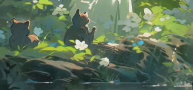

</div>
# I'm Charli
🌱 Sometimes I program a little 🌱
```json
{
  "main-languages": "Rust", "Javascript", "Python", "Lua"
  "less-used-languages": "C#", "Java", "C++", "Java", "Php"
}
```
<a href="https://discord.com/users/592044585883009036"></a>

## Visit my friends too! 🐢
- [Wilko](https://github.com/wilko-9)
- [Exyaaa](https://github.com/exyaaa)
- [Abigail](https://github.com/abigailchurch32)
- [LuukvanLuijn](https://github.com/LuukvanLuijn)
- [kbeckers1](https://github.com/kbeckers1) thank you for being such an amazing friend. rest well 💜  
  
## Caevern
🌱 Currently working on Caevern 🌱
```json
{
  "status": "In Development",
  "openxr": "Works, just missing rewrite to quaternions...",
  "unity": "Plugin almost supported",
  "godot": "Plugin not started yet",
  "why": "Wanted a long term project",
  "locked-in": true
}
```  
---
Merci de visiter mon profil! 💖
